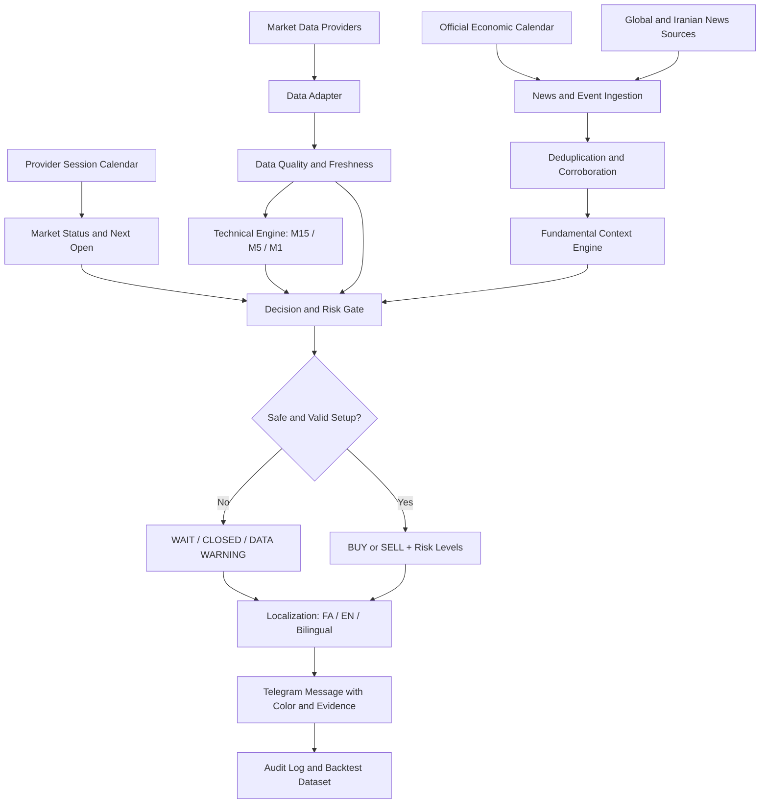
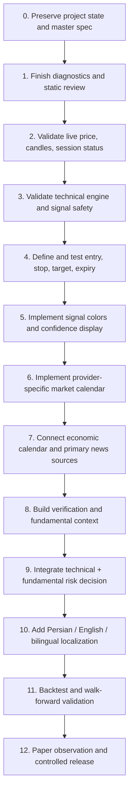

# GANJ GOLD — Master Specification & Project Archive

> Durable source of truth for decisions, requirements, roadmap, implementation status, and handover between conversations. Update after every substantial project conversation. Never store API keys, bot tokens, passwords, or other secrets here.

**Last updated:** 2026-11-06  
**Repository:** `GanjGoldTrader/ganj-gold-bot`  
**Development PR:** [#1 — MarketAPI diagnostics and live health check](https://github.com/GanjGoldTrader/ganj-gold-bot/pull/1)

## 1. Archive maintenance rules
- At the end of every substantial GANJ GOLD conversation, identify new requirements, decisions, corrections, discoveries, code changes, test results, and open questions.
- Update the relevant sections and append a dated entry to Project archive / decision log.
- Label each item Confirmed, Proposed, In progress, or Pending validation. Never present a proposal as an agreed implementation.
- Commit documentation changes to the active development branch and include them in the appropriate PR. Do not merge or deploy without the release gates below.
- At the start of a new project conversation, read this file and inspect current GitHub/PR/CI state. Current repository state supersedes old chat summaries.

## 2. Objective and principles
Build a reliable XAUUSD short-term analysis assistant combining technical analysis, market-data quality checks, fundamental/news context, and clear Telegram alerts. Accuracy and capital preservation outrank signal frequency. Explain evidence and invalidation. Separate facts, reported claims, interpretation, and forecasts. Do not claim profitability without robust out-of-sample evidence.
**Scope:** analysis and alerts only. No automatic order placement, modification, or closing.

## 3. Confirmed strategy baseline
| Item | Baseline |
|---|---|
| Instrument | XAUUSD |
| Horizon | Generally 5–30 minutes |
| Planning move | About $5–$10; not guaranteed or a fixed TP rule |
| M15 | Main directional context / trend filter |
| M5 | Setup confirmation |
| M1 | Entry timing / trigger |
| Outputs | BUY, SELL, WAIT plus operational states |
| Visual reference | TradingView OANDA:XAUUSD |
| Execution | Alerts only; no automatic trades |

Risk/reward, volatility, spread, and regime must determine whether a setup is valid; the $5–$10 range is only a planning reference.

## 4. Signal colors and message contract
**Proposed palette — pending implementation and Telegram rendering tests:**
| Color | Label | Meaning |
|---|---|---|
| Green | BUY / خرید | Valid long setup after all filters pass |
| Red | SELL / فروش | Valid short setup after all filters pass |
| Yellow/amber | WAIT / صبر | No valid entry, incomplete confirmation, or conflicting evidence |
| Gray | MARKET CLOSED / NO DATA | Closed session, stale quote, missing data, or quality failure |
| Blue | NEWS ALERT / هشدار خبری | Material scheduled or unscheduled event |

Always show a literal text label; color alone is insufficient. A signal should show direction, calibrated confidence tier (only after validation), M15/M5/M1 reasoning, entry reference, stop-loss, take-profit, risk/reward, validity window, spread, quote timestamp, supporting/contradicting evidence, and invalidation conditions. Do not invent probability or price levels.

**Safety gates:** force WAIT or an operational warning if the provider reports closed, quotes are stale/malformed/crossed, candle history is missing/incomplete/misaligned, spread or volatility exceeds tested limits, or configured event-risk rules block trading. API failure is not the same as market closure.

## 5. Market calendar and time handling
- Store and compare timestamps in UTC; use timezone-aware datetimes everywhere.
- Display local times with an explicit timezone. Use IANA zones so daylight-saving changes are handled automatically.
- Use the actual configured provider/broker's official XAUUSD schedule as the operational authority. Providers do not necessarily share identical hours.
- Handle weekly closure, daily maintenance breaks, holidays, special sessions, and DST.
- Reconcile schedule with provider status/quote freshness. A schedule alone cannot prove a quote is live.
- Show next scheduled reopening only when the provider calendar supports a reliable calculation; otherwise state that it is subject to provider confirmation.

**Example only:** OANDA's published XAU/USD schedule has commonly been listed as Sunday 18:05 through Friday 16:59 New York time, with a daily maintenance interval around 17:00–18:05 New York time. This is not universal. Verify current official hours and the actual MarketAPI underlying source before implementing. Holidays and DST may change local-clock equivalents.

**Closed message (FA):** بازار XAUUSD در منبع قیمت فعلی بسته است. بازگشایی برنامه‌ریزی‌شده: [تاریخ، ساعت و منطقه زمانی]. تا دریافت قیمت معتبر، سیگنال خرید یا فروش صادر نمی‌شود.

**Closed message (EN):** XAUUSD is closed according to the configured provider. Scheduled reopening: [date, time, timezone]. No BUY/SELL signal will be issued until valid market data is available.

Use a distinct DATA STALE / DATA UNAVAILABLE message for API/data problems. Do not report market closed merely because an API request failed.

## 6. Fundamental analysis and news intelligence
Build a separate news/fundamental subsystem. It must collect, timestamp, deduplicate, corroborate, classify, and interpret material events, then pass structured context to the decision engine. Headlines alone must never directly trigger BUY/SELL.

### Candidate source groups (not all connected yet)
- US official macro/policy: Federal Reserve/FOMC; BLS (CPI, PPI, labor); BEA (PCE, GDP, income/spending); US Treasury; Census Bureau; ISM (clearly label as an industry association).
- Gold/commodities/positioning: World Gold Council, LBMA, CME/COMEX notices and data, CFTC COT (publication lag must be disclosed), EIA when energy context matters.
- International reporting and geopolitics: Reuters, Associated Press, Bloomberg and other reputable newsrooms; relevant government and international-organization primary statements.
- Iran: relevant official economic/monetary/energy/government releases, reputable Iranian news agencies, and independent reporting. Compare material claims across sources.
- Prefer primary sources, documented APIs, RSS, or licensed feeds. Respect terms, rate limits, and copyright. These are candidate sources, not a claim of existing API access.

### News verification record
For each material event retain canonical event ID/topic; original publication time and timezone; ingestion/update times; source and URL; primary/secondary classification; concise paraphrase; corroborating sources; contradictions, denials, corrections; status (unverified, single-source, corroborated, officially confirmed, disputed, corrected); category; affected assets; relevance; expiry/decay; and observed market reaction separately from predicted impact.

Do not treat syndicated copies of one wire story as independent corroboration. Preserve original publication time when an article is updated. Clearly label anonymous-source reporting, commentary, rumors, and unverified claims.

### Economic calendar
Track CPI/Core CPI, PPI/Core PPI, PCE/Core PCE, NFP, unemployment, hourly earnings, JOLTS, ADP (separate private estimate), FOMC decisions/minutes/press conferences/speeches, GDP, retail sales, ISM, jobless claims, relevant non-US central-bank decisions, and major geopolitical/trade/sanctions events.

For each release store scheduled time/timezone, previous, consensus, actual, revisions, source, release status, and retrieval timestamp. Never invent missing consensus. Keep revisions distinct from the first release.

### Fundamental interpretation and integration
Assess USD, nominal/real yields, rate expectations, inflation/growth/labor surprises, safe-haven demand, central-bank gold demand, ETF flows, futures positioning (with data lag), energy, and geopolitics. Avoid simplistic rules such as 'higher CPI always means gold falls'; consider expectations and observed reaction. Use configurable, tested event-risk windows. A news alert is not a trade signal. Technical and fundamental outputs remain separately visible; material event risk or contradictory verified information may downgrade a setup to WAIT.

## 7. Language and Telegram UX
Required modes: Persian, English, and bilingual (Persian first, English second). Recommended initial default: Persian, with a user-selectable preference. Keep localization separate from calculations and signal logic. Translate commands, errors, status, market-hours messages, news alerts, and signals consistently.

Message fields when available: status; market state; M15 trend; M5 confirmation; M1 trigger; entry; stop-loss; take-profit; validity; spread; data timestamp; rationale; invalidation. If a valid entry is absent, show WAIT and do not invent levels.

## 8. Target architecture
1. Market-data adapter (auth, quote/OHLCV, normalization, timestamps, retries, limits).
2. Provider session calendar (weekly/daily hours, holidays, DST, next open).
3. Data-quality/health layer (freshness, completeness, continuity, spread, provider status).
4. Technical engine (indicators and multi-timeframe setup).
5. News ingestion (primary feeds, RSS/API, source metadata, deduplication).
6. Economic calendar (scheduled/actual/forecast/previous values).
7. Verification/corroboration (independence, contradictions, corrections).
8. Fundamental context engine.
9. Decision/risk layer (technical + fundamental + event risk + data quality; may return WAIT).
10. Localization/presentation (FA, EN, bilingual; labels/colors).
11. Telegram interface and preferences.
12. Audit, replay, backtesting, and metrics.

### System flowchart

## 9. Current implementation status (last known 2026-11-06)
- Repository: `GanjGoldTrader/ganj-gold-bot`; development branch: `codex/diagnostics-healthcheck`.
- PR #1 is open and draft, base `main`, last known head `6a0ed81edeab2a56fa3dc76f17a384ff2b95dace`; not merged and production deployment not confirmed.
- PR changes: structured MarketAPI HTTP/network/timeout/response diagnostics; bounded error details and request IDs without logging API key; real `/status` XAUUSD health check; cache only successful LIVE health results for 30 seconds; better `/price` and `/candles` errors; README; tests; GitHub Actions.
- 13 tests were reported passing on the latest known PR workflow after two cache-behavior tests were added. Re-check current CI before relying on this.
- 2026-11-05 runtime: `/price` returned Bid 4088.87, Ask 4089.20, spread 0.33, status MARKET_CLOSED, timestamp 2026-11-05T21:58:59.992Z. Not a live tradable quote.
- `/candles` returned complete M1/M5/M15 history. `/signal` safely returned WAIT because quote was not LIVE.
- MarketAPI key was active with scopes read:history, read:latest, read:metadata, read:ohlcv, read:symbols. Never save or repeat the secret.
- These are historical test observations, not current prices/status.

## 10. Roadmap

| Phase | Work | Status |
|---|---|---|
| 0 | Master spec and archive | In progress |
| 1 | Diagnostics, tests, static review | PR #1; review ongoing |
| 2 | Live runtime validation during open session | Pending |
| 3 | M15/M5/M1 technical validation | Pending |
| 4 | Entry/SL/TP/validity and risk/reward rules | To design/test |
| 5 | Signal colors/confidence presentation | Proposed |
| 6 | Provider-specific market calendar/reopening alerts | Proposed |
| 7 | Economic calendar/news ingestion | Proposed |
| 8 | News corroboration/fundamental interpretation | Proposed |
| 9 | Technical/fundamental decision integration | Proposed |
| 10 | Persian/English/bilingual messages | Proposed |
| 11 | Backtest/out-of-sample/walk-forward validation | Pending |
| 12 | Paper observation and controlled release | Pending |

## 11. Test and release gates
- Review complete PR diff and current CI; verify secrets never enter logs or commits.
- Test LIVE, stale quote, closed session, daily break, holiday, DST boundary, API timeout, 401/403/429/5xx, malformed JSON, missing/incomplete candles, and rate limits.
- In an open session verify `/status`, `/price`, `/candles`, `/signal`; confirm WAIT on unsafe data.
- Confirm no automatic trade execution.
- Backtest with realistic spread, slippage, fees, latency, chronological splits, walk-forward and out-of-sample testing. Report sample size, expectancy, drawdown, profit factor, and cost sensitivity. Paper-observe before performance claims.

## 12. Project archive / decision log (newest first)
### 2026-11-06 — Permanent project archive requested
- Owner requested a durable repository document to preserve all prior and future agreements, features, roadmap and flowcharts across chats.
- Owner requested a closing routine: archive new decisions, requirements and work items at the end of each substantial project conversation.
- Added proposed color semantics, news/fundamental subsystem, multi-source corroboration, economic calendar, provider-specific session calendar/reopening notice, and Persian/English/bilingual UX.
- Status: recorded in roadmap; these features are not yet implemented.

### 2026-11-05 — MarketAPI runtime validation
- `/price` and `/candles` reached MarketAPI. Quote status was MARKET_CLOSED and timestamp was not live; do not treat as tradable.
- Complete M1/M5/M15 candles were returned. `/signal` correctly returned WAIT due to non-LIVE price.

### 2026-11-05 — Health-check cache correction
- Only successful LIVE health results are cached for 30 seconds; closed/stale results are rechecked.
- Added tests for LIVE caching and closed-market non-caching. Latest known PR workflow passed.

### 2026-11-05 — Diagnostics PR
- PR #1 created on `codex/diagnostics-healthcheck`; diagnostics, health check, README, tests and CI added.
- Signal logic unchanged. PR remains draft/open; not merged/deployed.

## 13. Open decisions
- Confirm exact broker/provider behind MarketAPI XAUUSD and its current official session calendar.
- Choose display timezone preference; UTC remains canonical.
- Select news/calendar feeds after checking API access, reliability, licensing, latency, and cost.
- Define event-risk windows using tests, not guesses.
- Calibrate confidence tiers from backtests.
- Finalize entry/stop/target/expiry rules; decide whether target adapts to ATR and spread.
- Confirm Persian default vs selectable language mode (recommended: selectable, Persian initial default).

## 14. Next actions
1. Review PR #1 diff and current CI; keep unmerged pending runtime validation.
2. Validate `/status`, `/price`, `/candles`, `/signal` during a confirmed open session.
3. Identify the actual MarketAPI underlying quote source and official session calendar.
4. Design a stable technical signal/risk output schema before changing signal logic.
5. Implement and test calendar/session handling and color/status rendering.
6. Evaluate economic calendar and news providers; build source adapters and corroboration.
7. Add localization templates without changing analytical calculations.
8. Update this archive at the end of every substantial project conversation.